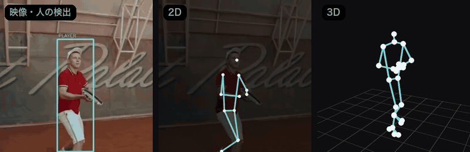
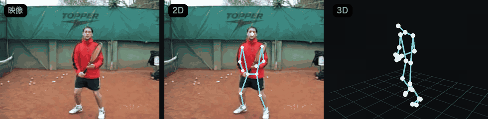

# tennis-3d-pose

単眼のテニス動画から、選手の 3D 骨格（26 関節）を推定する拡散モデル。

- **iPhone アプリ（App Store）**: [TennisPose3D](https://apps.apple.com/jp/app/tennispose3d/id6825789766) — 練習中にリアルタイムで 3D にして、フォームを声で一言コーチする
- **Web のデモ**: https://tennis-3d-pose.tennis-ai.workers.dev （撮った動画をあとから 3D にする。自分の動画で試すのは 1 人 1 日 3 回まで）
- コードは非公開（紹介用のリポジトリ）



<sub>Web 版。映像: Pexels（cottonbro studio）</sub>

## 背景
- プロや自分のフォームを 3D で細かく見たい
- 自分のフォームが合っているのか分からない。練習中にリアルタイムでコーチングしてくれる存在がほしい
- 高精度な大規模モデル（SAM 3D Body）は 1 コマ数秒かかり、気軽に使えない
- テニスの 3D の正解データは公開されていない。動きが速く、体で隠れる関節も多い
- → 2D 骨格から 3D を出す軽い拡散モデルを作り、大規模モデルの出力で蒸留する

## 参考文献・モデル・データ
- **手法**
  - [D3DP](https://arxiv.org/abs/2303.11579)（Shan+, ICCV 2023）— 2D 条件の拡散モデル、複数候補の集約
  - [MixSTE](https://arxiv.org/abs/2203.00859)（Zhang+, CVPR 2022）— 空間・時間の注意を交互に掛けるネットワーク
  - [DDPM](https://arxiv.org/abs/2006.11239)（Ho+, 2020）/ [DDIM](https://arxiv.org/abs/2010.02502)（Song+, 2021）/ [Improved DDPM](https://arxiv.org/abs/2102.09672)（Nichol & Dhariwal, 2021）
  - [知識蒸留](https://arxiv.org/abs/1503.02531)（Hinton+, 2015）
  - [One Euro filter](https://gery.casiez.net/1euro/)（Casiez+, CHI 2012）— 時間方向のならし
  - [Context-Aware PoseFormer](https://arxiv.org/abs/2311.03312)（Zhao+, NeurIPS 2023）— 2D 骨格のモデルの途中の特徴を 3D に使う
- **モデル**
  - [SAM 3D Body](https://github.com/facebookresearch/sam-3d-body)（Meta, 2025）— 蒸留の正解を作るモデル
  - [ViTPose](https://arxiv.org/abs/2204.12484)（Xu+, NeurIPS 2022）— 2D 骨格（Web 版）
  - [RTMPose](https://arxiv.org/abs/2303.07399)（Jiang+, 2023）— 2D 骨格の比べる基準
  - [MobileNetV3](https://arxiv.org/abs/1905.02244)（Howard+, ICCV 2019）— iPhone 版の自前の 2D 骨格のモデルの土台
  - [DARK](https://arxiv.org/abs/1910.06278)（Zhang+, CVPR 2020）— 2D のヒートマップから 1 画素より細かく位置を読む
  - [RT-DETR](https://arxiv.org/abs/2304.08069)（Zhao+, CVPR 2024）— 人の検出
- **データ**
  - [CMU Motion Capture](http://mocap.cs.cmu.edu/)・[AIST++](https://google.github.io/aistplusplus_dataset/)（[Li+, ICCV 2021](https://arxiv.org/abs/2101.08779)）— 事前学習
  - [Wikimedia Commons のテニス動画](https://commons.wikimedia.org/wiki/Category:Videos_of_tennis)（CC BY-SA 3.0）— 蒸留
  - [COCO](https://cocodataset.org/)（Lin+, ECCV 2014）— iPhone 版の 2D の学習（画像のライセンスが商用可のもの 12,442 枚だけ）
  - [3DPW](https://virtualhumans.mpi-inf.mpg.de/3DPW/)（von Marcard+, ECCV 2018）— 評価だけ（IMU で測った本物の 3D。学習には使わない）

## 手法
```
動画 → 人の検出 → 2D 骨格 17 点 ＋ 関節ごとの画像の特徴 → 拡散モデル → 3D 骨格 26 点 → ならす・骨の長さをそろえる
```
| | Web 版 | iPhone 版 |
|---|---|---|
| 人の検出 | RT-DETR | iPhone の Vision |
| 2D ＋ 特徴 | ViTPose-B | 自前のモデル（MobileNetV3、商用で使えるデータだけで学習） |
| 3D に使うコマ | 前後 81 コマ | 過去 27 コマ（1 秒 10 回） |
| ならし | One Euro（前向き・後ろ向きの平均） | One Euro（前向きだけ）＋ 骨の長さをそろえる |

- 3D のモデル: MixSTE 型（幅 128・4 層、約 123 万パラメータ、4.9 MB）。両方の版で同じ形
- 画像の特徴: 2D のモデルの途中の特徴（Web 版 768 次元・iPhone 版 1,216 次元）を関節の位置で取り出し、関節の入力に足す。2D の点だけでは分からない奥行きの手がかりになる（Context-Aware PoseFormer の考え方）
- 生成は 1 段・候補 1 つ。DDIM 10 段 × 候補 5 つの平均より精度が良く（テニスで MPJPE 49 → 45 mm）、3D の計算は約 50 倍速い
- 見えない関節は「空」として入力し、損失にも入れない
- iPhone 版の 2D: 公開の 2D のモデル（RTMPose など）は学習データに研究用のデータセットを含み、アプリでは使えない → 自前で作った。COCO の商用可の画像と、テニスの映像に SAM 3D Body を写した 2D で学習し、テニスの映像で RTMPose-s 並み（ずれ 0.067 対 0.066、膝の角度の差 5.5° 対 5.8°）

## 学習
1. **事前学習**: CMU・AIST++ の 3D を仮想カメラで 2D に写し、欠け・ずれ・外れ値を加えて学習
2. **蒸留**: テニス動画に SAM 3D Body をかけた 3D を正解とみなし、同じ映像の 2D から再現するように学習
- 蒸留の映像: Wikimedia Commons のテニス教本動画 10 本と、自分たちで撮影した映像 4 本

## 結果
学習に使っていないプロの映像 2 本（436 コマ）で、SAM 3D Body の出力との差。

| モデル | 足したデータ | MPJPE | PA-MPJPE |
|---|---|---:|---:|
| 事前学習のみ | CMU ＋ AIST++（テニスの動きはほぼ無い） | 103 mm | 65 mm |
| ＋ 蒸留 | Commons のテニス教本動画 10 本（約 5 分半） | 93 mm | 64 mm |
| **＋ 撮影（公開中）** | 自分たちで撮影した映像 4 本（約 2 分） | **86 mm** | **58 mm** |

- 撮り方の違う映像を少し足すだけで良くなる。次はテニスのスイングを撮り足す
- 評価の映像は 2 本だけなので、数 mm の差は誤差の範囲
- 課題: 奥行きの誤差（前かがみ・踏み込み・体の前後にある腕）

## 処理時間と精度
| | 2D | 3D に使うコマ | 1 コマあたり | プロの映像 2 本 | 3DPW |
|---|---|---|---:|---:|---:|
| SAM 3D Body | — | — | 約 4,000 ms | 基準 | 61 / 42 mm |
| **Web 版**（Mac CPU） | ViTPose-B | 前後 81 コマ | 74 ms | 86 / 58 mm | 96 / 65 mm |
| **iPhone 版**（iPhone 14） | 自前（MobileNetV3） | 過去 27 コマ | 21 ms<br>（2D 12 ms ＋ 3D 9 ms） | 91 / 68 mm | — |

- 精度は MPJPE / PA-MPJPE。プロの映像は SAM 3D Body の出力との差、3DPW は実測の 3D との差（屋外 24 本）
- 1 コマあたりの時間は、人の検出から 3D までの合計。33 ms 以内なら 1 秒 30 コマの映像に遅れない
- 方針: Web 版は撮った動画をあとから分析する用に精度を、iPhone 版は練習中のリアルタイムコーチング用に速さと、商用で使えることを優先する

## iPhone アプリ
[App Store](https://apps.apple.com/jp/app/tennispose3d/id6825789766)（無料。Pro は月額・年額のサブスクリプション）



<sub>iPhone 版と同じ処理（自前の 2D ＋ 3D を 1 秒 10 回）を Mac で再現。映像: Wikimedia Commons「0DRIVE」（Dardo 86 7, CC BY-SA 3.0。この GIF も CC BY-SA 3.0）</sub>

- 横に置いて振るだけで、2D の骨格を 3D にしてスイングを解析し、気になる所を声で一言。計算はすべて iPhone の中
- iPhone 14 で 1 秒 30 コマ。声の一言が正解と同じだったのはフォアハンド 40 本中 38 本
